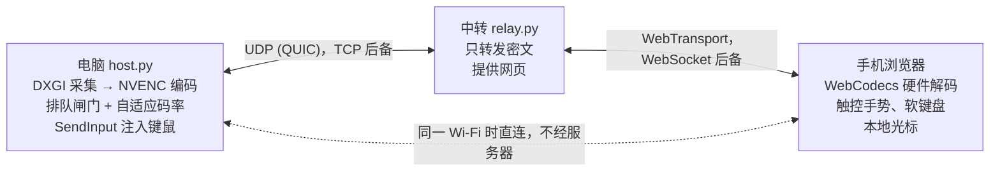

# MiniDesk

**极简远程桌面：用手机浏览器触控操作 Windows 电脑。手机端只是一个 54 KB 的网页，安卓无需安装任何 App。**

*A tiny remote desktop: control your Windows PC from the phone's browser. The phone side is a 54 KB web page — nothing to install on Android.*

ToDesk 一类工具的极简版：只做两件事——看屏幕、控制鼠标和键盘，其余功能一概不要，目标是延迟最低、代码最少。

## 有多小

| 部分 | 代码 | 压缩后 |
|---|---|---|
| 手机端（网页：HTML + JS） | **54 KB** | 19 KB |
| 电脑端（Python + Cython/C++ 采集与输入） | **71 KB** | 24 KB |
| 中转服务器（Python） | **21 KB** | 7 KB |
| 合计（约 3600 行，含部署脚本） | 156 KB | 53 KB |

网页端不用任何框架，也没有构建步骤；加密只用浏览器自带的 WebCrypto。电脑端运行时依赖 Python 和 PyAV（自带 FFmpeg，用来做 H.264 编码），这些不算在上表里。

## 特点

- **安卓无需安装 App**：Chrome 打开链接就能用，可以添加到主屏幕，横屏全屏。
- **低延迟**：
  - 电脑端用 DXGI 桌面复制采集（Cython，不占 GIL），用 NVENC 硬件编码（零延迟参数）；手机端用 WebCodecs 硬件解码。
  - 2560×1440 下采集 2.9 ms、编码 6.2 ms（RTX 4060）。
  - 同一 Wi-Fi 时直连电脑：实测往返 4–10 ms，30–50 fps。
- **网络差也扛得住**：
  - 经服务器时走 UDP（QUIC / WebTransport），每帧单独一条流，丢一个包只耽误那一帧。
  - 端到端的排队控制和自适应码率不让数据在路上堆积；本机模拟 10% 丢包时仍有约 30 fps。
  - 浏览器不支持或 UDP 被封时，自动退回 TCP。
- **端到端加密**：ECDH + AES-GCM，配对密钥只在二维码里。中转服务器只转发密文，看不到画面，也冒充不了任何一端。
- **手机打中文不用切电脑输入法**：手机输入法打出的文字以 Unicode 直接注入电脑，中英文只在手机上切换。
- **为触屏设计**：
  - 触控板和触控两种模式；双指滚动（带惯性）、捏合缩放，三指平移。
  - 快捷键栏：Ctrl/Alt/Shift/Win 粘滞键，复制、粘贴、切换窗口等一键组合。
  - 光标在手机本地绘制，移动零延迟。
- **用起来简单**：
  - 双击桌面图标，弹出带二维码的连接窗口；手机配对一次后就不用再扫。
  - 不开机自启；被控时屏幕顶部有提示条和“断开”按钮。

## 原理



设计细节、实测数据和踩过的坑见 [ARCHITECTURE.md](ARCHITECTURE.md)。

## 需要什么

- **电脑**：Windows 10/11 64 位，Python 3.10+。有 NVIDIA 显卡时用 NVENC 编码，没有则退回 x264 软件编码（CPU 占用更高）。编译原生模块需要 MinGW-w64（实测 GCC 13.2）。
- **一台有公网 IP 的服务器**做中转（Windows 或 Linux 都行）。同一 Wi-Fi 时手机直连电脑，不经过它。
- **手机**：安卓 Chrome（已实测）。iPhone 的 Safari 理论上可用（会走 TCP），未实测。

## 快速开始

**1. 编译**（在电脑上）

```bash
git clone https://github.com/mty194911-cm/minidesk.git
cd minidesk
pip install -r requirements.txt
python setup.py build_ext --inplace
```

**2. 生成服务器安装包**

```bash
python deploy.py 你的服务器公网IP
```

这一步会建一个自己的根证书（私钥只留在本机的 `certs/`），为服务器 IP 签发证书、生成 token，写好本机的 `config.json`，并打包出 `dist/minidesk-relay.zip`。

**3. 部署中转服务器**

把 `dist/minidesk-relay.zip` 复制到服务器上解压，然后：

- **Windows 服务器**：双击 `install.cmd`。它会装好 Python 和依赖，注册开机任务（低权限账户运行），并在防火墙放行端口。
- **Linux 服务器**：

  ```bash
  cd minidesk-relay
  python3 -m venv venv
  venv/bin/pip install aiohttp "aioquic>=1.3,<1.8"
  sudo MINIDESK_TOKEN=$(python3 -c "import json; print(json.load(open('relay.json'))['token'])") \
      venv/bin/python relay.py --port 443 --cert server.crt --key server.key
  ```

  要常驻后台可以交给 systemd 或 tmux。中转是纯 Python，Windows 专用的调用都有判断，但只在 Windows 上实测过。

最后在云服务商的安全组里放行这个端口的 **TCP 和 UDP**（默认 443）。UDP 不放行也能用，只是会退回 TCP，网络差时效果差很多。装好后删掉服务器上的 zip，里面有服务器私钥和 token。

**4. 电脑**

```bash
python host.py --shortcut
```

桌面上会出现「MiniDesk」。以后双击它就会启动，并弹出连接窗口：

- 窗口里有实时状态和二维码；已经在运行时再双击，会把窗口重新调出来。
- 关掉窗口只是隐藏，程序在后台继续运行；要彻底退出，点窗口里的「退出 MiniDesk」。

**5. 手机**（每台手机只做一次）

1. 在连接窗口切到「新手机先装证书」，扫码下载根证书并安装（安卓：设置里搜索“证书” → 安装证书 → CA 证书）。
2. 切回「经服务器」，扫码完成配对，再把网页添加到主屏幕。之后点主屏图标就能连，不用再扫。

有域名的话，也可以用 Caddy 之类的反向代理自动申请正式证书，手机就不用装根证书了（但这样就用不了局域网直连）。

## 已知限制

- 被控端只支持 Windows，只采集主显示器，不传声音。
- 被控端是普通用户进程，操作不了 UAC 弹窗、锁屏和以管理员身份运行的窗口。
- 经服务器的延迟主要取决于服务器离你多远。手机走蜂窝网络、服务器又在海外时，往返会有 300 ms 以上；国内运营商还可能每隔一两分钟卡住一条 UDP 连接，这时 MiniDesk 会在 3 秒后自动换一条新连接。

## 测试

```bash
python tests/test_e2e.py [--tls]          # 端到端：配对、直连切换、踢出
python tests/test_quic.py [--loss 0.1 --busy --nodecode]   # UDP 路径与丢包
python tests/test_adapt.py                # 模拟晚高峰线路和 4G 下的排队与码率
```

## 许可

[MIT](LICENSE)
